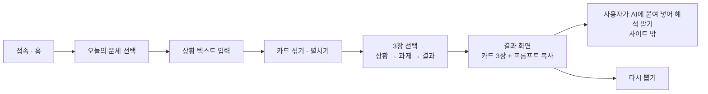
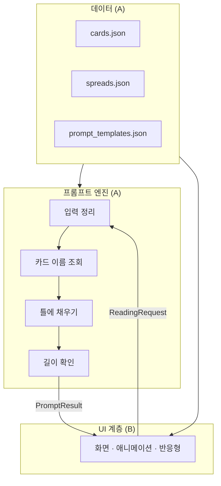
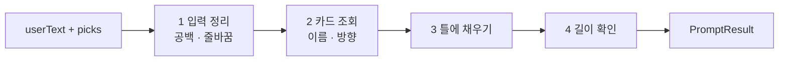

# 타로카드 사이트 개발 문서

| 항목 | 내용 |
|---|---|
| 문서 버전 | v1.0 (2026-11-11) — 설계대로 사이트 구현 완료(메뉴 5종, 프롬프트 복사). 구현 상태는 README 참고 |
| 저장소 | https://github.com/hook252597/Tarot |
| 개발 인원 | 2명 — **A(박정열)**: 시스템·파이프라인 설계(카드 데이터, 프롬프트) / **B(동업자)**: 화면 설계, 카드 디자인, 글꼴, 사이트 이름 |
| 배포 | GitHub Pages (PC·모바일 반응형 웹) |
| 1차 목표(MVP) | 메뉴(스프레드) 선택 → 상황 입력 → 카드 선택 → 뽑은 카드 + AI용 프롬프트 복사. 대표 메뉴는 **오늘의 운세**, 기존 스프레드 4종도 메뉴로 제공 |

> 이 문서는 프로젝트의 기준 문서입니다. 역할별 상세 작업은 `docs/TASKS_A_DATA_PIPELINE.md`, `docs/TASKS_B_UIUX.md`, 요청 자료는 `docs/ASSET_REQUESTS.md` 로 분리합니다(다음 단계에서 작성).
> `[결정 필요]` 표시는 두 사람이 합의해야 확정되는 항목이며, 13장에 모아 두었습니다.

---

## 1. 서비스 개요

사용자가 오늘의 상황을 글로 적고, 펼쳐진 카드 중 3장을 직접 고르면, **뽑은 카드 그림과 함께 "입력한 글 + 뽑은 카드"를 담은 AI용 프롬프트**를 제공하는 사이트. 사용자는 프롬프트를 복사해 자신이 쓰는 AI(ChatGPT·Claude·Gemini 등)에 붙여 넣어 해석을 받는다.

**사이트는 해석 문장을 직접 만들지 않는다.** 사이트의 역할은 카드를 뽑는 경험과, 좋은 해석이 나오도록 잘 짜인 프롬프트를 만들어 주는 것이다.

### 1.1 MVP 범위

| 포함 | 하지 않음(확정) |
|---|---|
| 메뉴 5종: 오늘의 운세(3장) + 원 카드(1) · 쓰리 카드(3) · 관계 스프레드(7) · 켈틱 크로스(10) | 사이트 내 해석 문장(규칙 기반·AI 직접 호출 모두) |
| 상황 텍스트 입력 | 회원가입·로그인·닉네임 |
| 카드 섞기·펼치기·스프레드 장수만큼 선택 | 하루 1회 제한 — 횟수 제한 없음 |
| 뽑은 카드 표시(그림·이름·방향·자리) | 쿠키·세션·브라우저 저장소 |
| AI용 프롬프트 생성·복사 | 지난 운세 다시 보기(확장 계획도 없음) |
| PC·모바일 반응형 | 서버, 결제, 광고, 방문 통계 |

이후 단계에서 검토할 수 있는 것: 새 스프레드 추가(하나씩), 자체 디자인 카드 덱, 프롬프트 말투 선택, 다국어.

### 1.2 오늘의 운세 — 3장의 자리(포지션)

| 순서 | 자리 | 의미 | AI가 답해야 하는 질문 |
|---|---|---|---|
| 1 | **상황** | 오늘 내가 놓인 상황 | "오늘 나의 하루는 어떤 흐름인가?" |
| 2 | **과제** | 오늘 꼭 해야 하는 일 | "오늘 내가 놓치면 안 되는 것은 무엇인가?" |
| 3 | **결과** | 상황과 과제가 맞물린 끝 | "그렇게 했을 때 오늘은 어떻게 마무리되는가?" |

---

## 2. 현재 저장소 상태 (2026-11-10 기준)

이미 동작하는 프로토타입 **「달빛 아르카나」** 가 있습니다. 이것을 기반으로 발전시킵니다.

| 파일 | 현재 내용 | 처리 방향 |
|---|---|---|
| `index.html` | 스프레드 선택 → 주제 입력 → 카드 선택 → 해석, 4개 화면 | 구조 유지. 첫 화면에 오늘의 운세 메뉴 추가, 해석 화면을 "카드 + 프롬프트 복사" 화면으로 변경 |
| `css/style.css` | 다크/라이트 테마 | B의 디자인 시안에 맞춰 교체·정리 |
| `js/data.js` | 78장 정/역방향 한 줄 의미(156개) + 스프레드 4종 | **`data/*.json` 으로 분리** — 카드 이름·이미지만 옮기고 의미 문장은 삭제, 스프레드 4종은 메뉴로 유지 (A) |
| `js/app.js` | 화면 흐름 + 해석 문장 생성 | 해석 생성 코드(`interpretCard`, `summarize`) **삭제**, 프롬프트 생성으로 대체 |
| `cards/` | 라이더–웨이트–스미스 78장(퍼블릭 도메인) | 임시 이미지로 사용, B의 디자인으로 교체 가능하게 (7.3) |

**확인된 정리 사항**
- 작업 폴더 전체 파일이 Git에서 "수정됨"으로 보임 → 내용 변경이 아니라 **줄바꿈(CRLF/LF) 차이**. `.gitattributes` 추가로 해결(10.3).
- 현재 역방향 확률이 30%로 코드에 고정 → 50%로 변경하고 설정값으로 분리.
- 현재 Google Fonts를 외부에서 불러옴 → 글꼴 종류와 불러오는 방식은 B가 결정(13장).

---

## 3. 사용자 흐름



| # | 화면 | 사용자 행동 | 시스템 동작 | 담당 |
|---|---|---|---|---|
| S1 | 홈 | 메뉴 선택 | 메뉴 5종 표시(오늘의 운세를 대표로), 추후 메뉴 추가 자리 확보 | B |
| S2 | 상황 입력 | 상황·고민을 글로 입력(선택) | 최대 2,000자, 비워도 진행 가능 | B(화면) · A(검증 규칙) |
| S3 | 카드 선택 | 펼쳐진 카드 중 스프레드 장수만큼 선택 | 섞기 애니메이션, 선택 순서대로 자리에 배치 | B |
| S4 | 결과 | 카드 뒤집기, 프롬프트 복사 | 카드 3장(그림·이름·방향·자리) 표시, 프롬프트 생성·미리보기, 복사 완료 표시, 사용 방법 안내 | A(프롬프트) · B(화면) |

**예외 흐름**
- 입력이 비었을 때: 그대로 진행(입력은 선택). 프롬프트의 주제/고민 칸이 비고 "공란이면 무시" 문구가 처리
- 새로고침·재방문: 처음부터 다시 시작(진행 상태를 저장하지 않음)
- 복사 기능이 막힌 브라우저: 프롬프트 글 상자를 직접 선택해 복사할 수 있게 표시

---

## 4. 아키텍처

핵심 원칙: **화면(UI)과 프롬프트 엔진과 데이터를 분리**한다. 두 사람이 서로의 파일을 건드리지 않고 병렬로 작업하고, 스프레드·덱·프롬프트 문구를 바꿔도 다른 부분이 깨지지 않게 하기 위함.



서버 없음. 모든 동작은 브라우저 안에서 이루어지고 외부로 나가는 데이터가 없다.

### 4.1 UI ↔ 엔진 인터페이스 (두 사람의 약속)

UI는 아래 함수 하나만 호출한다.

```js
// js/engine/index.js
const result = TarotEngine.buildPrompt(request);
```

**ReadingRequest**
```json
{
  "spreadId": "today",
  "userText": "오늘 팀 프로젝트 발표가 있는데 준비가 덜 된 것 같아 불안해요",
  "picks": [
    { "positionId": "situation", "cardId": "major-16", "orientation": "upright" },
    { "positionId": "task",      "cardId": "pents-08", "orientation": "upright" },
    { "positionId": "outcome",   "cardId": "cups-10",  "orientation": "reversed" }
  ]
}
```

**PromptResult**
```json
{
  "text": "…복사할 프롬프트 전문…",
  "length": 1290
}
```

### 4.2 해석 방식 — 확정

| 항목 | 결정 |
|---|---|
| 사이트 내 해석 문장 | **만들지 않음** (규칙 기반 해석 삭제) |
| 사이트가 AI를 직접 호출 | **하지 않음** (서버·API 키·과금 없음) |
| AI 해석 | **프롬프트 복사 방식만 제공** |
| 해석 품질 | 사용자가 쓰는 AI에 따라 달라지며 관리하지 않음(감수) |

### 4.3 프롬프트 설계

프롬프트는 **고정 틀 + 칸 채우기**로 조립한다. 채우는 칸은 스프레드명, 사용자 입력, 카드 3장(이름·방향), 자리 의미뿐이며 나머지는 모두 고정 문구다.

**프롬프트 틀 — 오늘의 하루 엿보기** (`{ }` 가 채워지는 칸. 공통 틀에서 보조 카드 항목과 조언 금지 규칙을 뺀 형태)

```
당신은 타로 전문 리더다. 당신은 [{스프레드명}] 스프레드를 해석한 뒤 나와 대화하며 자세한 타로 리딩을 이어나가야 한다.

주제/고민(공란이면 무시) : {사용자 입력}

뽑은 카드 : 첫 번째 카드([{카드1}])의 의미(공란이면 무시) : {자리1 의미}
두 번째 카드([{카드2}])의 의미(공란이면 무시) : {자리2 의미}
세 번째 카드([{카드3}])의 의미(공란이면 무시) : {자리3 의미}


생각 순서 : 
1. 대상 파악 : "대상"이란 내담자 본인(나) 혹은 질문의 주체가 되는 제3자(그 사람, 상대방)를 나타냄. 초기에 입력한 주제/고민을 통해 리딩의 대상이 누구인지 정확히 파악하라.
2. 의도 파악 : 내가 던진 질문 속 숨은 의도와 맥락을 추론하라. 이때 구체적인 답변을 위해 질문을 다양한 세부 질문으로 나누어 심도 있게 생각하라.
3. 카드의 의미 정리 : 각 카드는 양면성을 가지고 있다. 긍정적·부정적 의미를 모두 고려하라. 이때 카드 간 비슷한 코트, 슈트, 숫자, 속성이 반복될 경우 해석에 반영하라.
4. 역방향 카드가 있을 경우, 정방향 카드가 가지고 있는 의미의 약화, 과도한 강화, 혹은 반대 의미로 해석. 자연스러운 방향으로 취사 선택.
5. 카드 조합 및 순서 해석 : 각 카드를 개별적으로 보지 말고, 카드 간 조합에서 생기는 고유한 흐름과 의미를 찾기
6. 질문과 카드 연결 : 카드의 의미와 해석을 결합하여 질문 상황에 가장 설득력 있는 해석을 도출하라.

첫 번째 출력 형식 :
첫 번째 문단. 결론부터 명료하게 설명
두 번째 문단 ~ . 각각의 카드를 한 문단씩 자세히 설명
마지막 문단. 해석의 근거가 무엇인지 논리적으로 자세히 설명

첫 번째 이후 출력 형식 :
앞선 내용을 바탕으로 나와 대화하며 해석 구체화 및 상담을 이어나가라.

* 스타일 규칙 : 반드시 존댓말 사용. 쉬운 일상 대화체로 작성. 현실적인 예시 포함. 소제목은 볼드체 출력. 문단 중간에는 볼드체 금지. 긍정 혹은 부정 해석을 유도해도, 해석의 큰 흐름은 변동 없이 유지. 너무 구체적인 묘사나 비유, 수치, 전략, 행동은 들지 말 것. Return only the main response. Remove pre-text and post-text.
```

**칸 채우기 규칙**

| 칸 | 채우는 값 | 출처 |
|---|---|---|
| `{스프레드명}` | 오늘의 하루 엿보기 | `spreads.json` |
| `{사용자 입력}` | S2에서 입력한 글. 비어 있으면 빈칸 그대로("공란이면 무시"가 처리) | 사용자 |
| `{카드n}` | 카드 이름. 역방향이면 뒤에 ` (역방향)`, 정방향은 표시 없음 | `cards.json` |
| `{자리n 의미}` | 상황: 오늘 나의 전반적인 상황 / 과제: 오늘 내가 집중해야 할 과제 또는 도전 / 결과: 오늘의 과제와 상황이 가져올 결과 | `spreads.json` |

**길이 — 상한을 두지 않음 (확정)**
- 프롬프트 길이는 스프레드(카드 수, 켜진 항목)와 사용자 입력 길이에 따라 달라지며, **고정하거나 자르지 않음**
- 참고 수치(입력 글 제외): 오늘의 하루 엿보기 약 1,150자, 켈틱 크로스(10장)는 카드 줄이 늘어 약 1,700자 안팎
- 결과 화면에 글자 수를 참고로 표시할지는 B와 협의
- 입력 칸: **최대 2,000자**(확정). 프롬프트 길이를 맞추기 위한 것이 아니라 오작동 방지용 한도
- 카드별 의미 문장은 프롬프트에 넣지 않음(카드 이름과 방향만 전달, 해석은 AI가 수행)

**공통 틀과 스프레드별 차이 (확정)**

보내주신 원문은 "앞으로 추가될 스프레드가 따라야 할 형식"을 보여주는 **공통 틀**이다. 스프레드마다 아래 항목만 켜고 끈다.

| 항목 | 공통 틀 | 오늘의 하루 엿보기 | 정하는 곳 |
|---|---|---|---|
| 생각 순서 "보조 카드" 항목 | 있음 | **뺌**(보조 카드 없음) | `spreads.json` 의 `hasSupportCards` |
| 스타일 규칙 "조언점은 내가 요청하기 전까지 출력하지 말 것" | 있음 | **뺌**(과제 자리가 조언을 먼저 요청하는 스프레드) | `spreads.json` 의 `adviceOnRequestOnly` |
| 카드 줄 수 | 카드 수만큼 | 3줄 | `cardCount` |
| 스프레드명·자리별 의미 | 스프레드마다 다름 | 6.2 참고 | `promptName`, `positions[].promptMeaning` |
| 스프레드 전용 해석 지침 | 없음 | 없음 | `spreads.json` 의 `readingGuide` (있을 때만 생각 순서의 "카드 조합 및 순서 해석" 뒤에 붙음) |
| 생각 순서 번호 | 항목을 빼면 자동으로 다시 매김 | 1~6 | 엔진 |

**스프레드 전용 해석 지침 — 켈틱 크로스**

켈틱 크로스는 10장을 따로따로 읽으면 해석이 흩어지므로, 함께 읽어야 하는 카드 묶음을 프롬프트에 알려준다(참고 자료 15장의 켈틱 크로스 가이드 기준).

| 묶음 | 자리 | 프롬프트에 넣을 지침(요지) |
|---|---|---|
| 가로 흐름 | 3 → 1 → 4 → 10 | 이야기의 뼈대. 가장 먼저 읽고 나머지 카드는 여기에 덧붙인다 |
| 세로 흐름 | 6 → 1 → 5 | 내면이 현재와 바라는 미래에 주는 영향. 6번은 본인도 모르는 무의식일 수 있다 |
| 내면과 두려움 | 6 + 9 | 묶어서 읽고 두 해석이 서로 모순되지 않게 한다 |

- 카드를 끊어 읽지 말고 하나의 이야기로 잇도록 지시
- 공통 틀의 출력 형식("각각의 카드를 한 문단씩")은 10장에서는 길고 끊어져 보일 수 있음 → 켈틱 크로스는 묶음 단위로 설명하게 할지 시험 후 결정 `[결정 필요]`
- 참고 가이드는 해석을 마친 뒤 조언을 주는 형식 — 현재 켈틱 크로스는 조언 금지 규칙이 켜져 있음. 유지할지 시험 후 재검토 `[결정 필요]`
- 다른 스프레드도 같은 방식으로 `readingGuide` 를 추가할 수 있음

**스프레드 전용 해석 지침 — 관계 스프레드(7장)**

기존 5장 구성을 참고 자료(15장)의 7장 배열로 바꾼다. 자리: ① 나 ② 상대 ③ 두 사람의 관계 ④ 내가 원하는 것 ⑤ 상대가 원하는 것 ⑥ 관계의 과제 ⑦ 관계의 가능성과 흐름.

| 묶음 | 자리 | 프롬프트에 넣을 지침(요지) |
|---|---|---|
| 두 사람의 태도 | ① ↔ ② | 나와 상대가 관계를 대하는 태도와 에너지의 차이를 비교 |
| 관계의 분위기 | ①·② → ③ | 두 사람의 상태가 만나 어떤 분위기를 만드는지 |
| 원하는 방향 | ④ ↔ ⑤ | 서로 바라는 방향이 같은지 다른지 비교 |
| 과제와 흐름 | ③ → ⑥ → ⑦ | 지금의 관계와 과제가 이어질 때 향하는 방향 |

해석 태도에 대한 지침(이 스프레드 전용)
- ② 상대 카드는 속마음을 단정하지 말고, 겉으로 드러나는 태도와 관점으로 읽는다
- ⑥ 과제에 어려운 카드가 나와도 관계의 끝으로 읽지 않고 풀어야 할 핵심 과제로 읽는다
- ⑦은 확정된 결말이 아니라 지금의 흐름이 이어질 때의 방향으로 읽는다. 좋은 카드도 결과를 보장하지 않는다

조언 금지 규칙: **끔**(확정) — 7장 구성에서도 해석과 함께 조언을 받는다

**카드 이름 표기 (확정)**: 기존 데이터(`js/data.js`) 양식으로 통일 — 메이저는 이름 그대로(`탑`), 마이너는 **수트 + 랭크**(`컵 페이지`, `소드 에이스`, `펜타클 5`). 역방향은 뒤에 ` (역방향)`. 영문명은 붙이지 않음.

**사용자 입력의 줄바꿈**: 공백으로 바꿔 한 줄로 넣음(틀 구조가 흐트러지지 않게).

### 4.4 틀 관리
- 공통 틀 원문은 `data/prompt_templates.json` 에 저장하고 버전을 붙임(`common-v1`). 문구를 고칠 때 코드는 건드리지 않음
- 고정 문구(생각 순서, 출력 형식, 스타일 규칙)는 스프레드가 달라져도 공통으로 쓰고, 스프레드마다 달라지는 것은 스프레드명·카드 줄·선택 블록(보조 카드 등)뿐
- 문구를 바꿀 때는 같은 카드·같은 입력으로 주요 AI 2~3종에 넣어 전후 비교

### 4.5 Python의 역할

브라우저에서는 Python이 돌지 않으므로 개발 도구로만 씁니다.
- `tools/build_data.py` — 기존 `js/data.js` 의 내용을 `data/cards.json` 으로 변환
- `tools/validate_data.py` — 78장 누락·중복·이름 표기 규칙·이미지 파일 존재 확인, 스프레드별 프롬프트 조립 결과 확인

---

## 5. 목표 디렉토리 구조

```
Tarot/
├─ index.html
├─ css/
│  ├─ tokens.css          # 색·글꼴·간격 변수 (B)
│  └─ style.css           # 화면 스타일 (B)
├─ js/
│  ├─ app.js              # 화면 흐름·상태 (B 주도, A 협업)
│  ├─ ui/                 # 화면별 렌더링·애니메이션 (B)
│  └─ engine/             # 프롬프트 엔진 (A)
│     ├─ index.js         # buildPrompt() — UI가 부르는 유일한 입구
│     ├─ prompt.js        # 틀 채우기·길이 확인
│     └─ data.js          # JSON 로딩
├─ data/                  # (A)
│  ├─ cards.json
│  ├─ spreads.json
│  └─ prompt_templates.json
├─ assets/
│  ├─ decks/rws/          # 현재 cards/ 이미지 이동 (덱 단위 폴더)
│  ├─ fonts/              # 글꼴 파일(직접 포함 시)
│  └─ ui/                 # 아이콘·배경·카드 뒷면 (B)
├─ tools/                 # Python 스크립트 (A)
├─ docs/                  # 문서
├─ .gitattributes
└─ README.md
```

---

## 6. 데이터 설계 (A)

### 6.1 `cards.json` — 카드 1장

```json
{
  "id": "major-16",
  "arcana": "major",
  "suit": null,
  "number": 16,
  "nameKo": "탑",
  "nameEn": "The Tower",
  "image": "major-16.jpg"
}
```

- 카드 구성: 메이저 22장 + 마이너 56장(완드·컵·소드·펜타클 각 14장) = **78장**. 역방향은 뽑을 때 50% 확률로 정해지는 상태이며 카드 데이터에는 따로 없음(카드×방향 경우의 수 156)
- 프롬프트에 필요한 것은 **이름과 방향뿐** → 카드별 의미 문장은 두지 않음. 기존 `js/data.js` 의 한 줄 의미 156개는 **삭제**(확정)
- `id` 는 이미지 파일명 규칙과 동일(`major-00`~`major-21`, `wands|cups|swords|pents-01`~`14`). 현재 코드와 호환
- 이름 표기는 기존 데이터 양식 그대로(4.3) → 변환만 하면 됨

### 6.2 `spreads.json` — 스프레드(펼침 방식)

```json
{
  "id": "today",
  "menuName": "오늘의 운세",
  "promptName": "오늘의 하루 엿보기",
  "cardCount": 3,
  "positions": [
    { "id": "situation", "nameKo": "상황", "promptMeaning": "오늘 나의 전반적인 상황" },
    { "id": "task",      "nameKo": "과제", "promptMeaning": "오늘 내가 집중해야 할 과제 또는 도전" },
    { "id": "outcome",   "nameKo": "결과", "promptMeaning": "오늘의 과제와 상황이 가져올 결과" }
  ],
  "layout": "row-3",
  "promptTemplateId": "common-v1",
  "hasSupportCards": false,
  "adviceOnRequestOnly": false
}
```

새 메뉴는 이 파일에 항목을 추가하는 것으로 생기도록 UI·엔진을 만든다. 화면에 보이는 메뉴 이름과 프롬프트에 들어가는 스프레드 이름을 따로 둔다.

**MVP 메뉴 5종** — 기존 스프레드 4종도 같은 형식(공통 틀)으로 프롬프트를 만든다. 자리별 의미는 기존 데이터의 설명을 옮긴 초안이며 상세는 `TASKS_A_DATA_PIPELINE.md` A-2.

| `id` | 메뉴 | 장수 | 보조 카드 | 조언 금지 규칙 | 배치 |
|---|---|---|---|---|---|
| `today` | 오늘의 운세 | 3 | 없음 | 끔(과제 자리가 조언 요청) | 한 줄 3장 |
| `one` | 원 카드 | 1 | 없음 | 켬 | 1장 |
| `three` | 쓰리 카드(과거·현재·미래) | 3 | 없음 | 켬 | 한 줄 3장 |
| `relationship` | 관계 스프레드 | 7 | 없음 | 끔 | 4줄(1·2·3·1, 참고 글 그림), 전용 해석 지침 있음(4.3) |
| `celtic` | 켈틱 크로스 | 10 | 없음 | 켬 | 십자 + 세로 4장, 전용 해석 지침 있음(4.3) |

### 6.3 `prompt_templates.json` — 프롬프트 틀

```json
{
  "id": "common-v1",
  "header": "당신은 타로 전문 리더다. 당신은 [{spreadName}] 스프레드를 해석한 뒤 …",
  "topicLine": "주제/고민(공란이면 무시) : {userText}",
  "cardLines": ["첫 번째 카드([{card}])의 의미(공란이면 무시) : {meaning}", "두 번째 카드…", "세 번째 카드…"],
  "thinkingSteps": ["1. 대상 파악 : …", "…"],
  "optionalSteps": { "supportCard": "보조 카드 : 보조 카드는 메인 카드의 의미를 자세하게 좁히는(교집합) 역할." },
  "optionalRules": { "adviceOnRequestOnly": "조언점은 내가 요청하기 전까지 출력하지 말 것." },
  "outputFormat": "첫 번째 출력 형식 : …",
  "styleRules": "* 스타일 규칙 : …"
}
```

---

## 7. 프롬프트 파이프라인 (A)



| 단계 | 내용 |
|---|---|
| 1 입력 정리 | 앞뒤 공백 제거, 줄바꿈을 공백으로, 2,000자 초과분 자르기. 빈 입력은 빈칸 그대로 |
| 2 카드 조회 | `picks` 의 카드 ID·방향으로 `cards.json` 에서 이름 조회, 역방향이면 ` (역방향)` 붙임 |
| 3 틀에 채우기 | `prompt_templates.json` 의 블록 순서대로 조립 |
| 4 길이 확인 | 글자 수 계산(화면 표시·검증용) |

화면에 프롬프트를 표시할 때는 HTML로 해석되지 않도록 글자로만 넣는다(`textContent`).

### 7.2 카드 뽑기 규칙
- 78장을 매번 무작위로 섞고, 사용자가 누른 순서대로 상황→과제→결과에 배정
- 역방향 사용, 확률 **50%**(확정) — 설정값으로 분리
- **횟수 제한 없음** — 원하는 만큼 다시 뽑을 수 있음

### 7.2.1 사용자 구분·저장을 하지 않음 (확정)

- 쿠키, 세션, 브라우저 저장소(localStorage·sessionStorage·IndexedDB) **사용하지 않음**
- 진행 상태(입력 글, 뽑은 카드, 프롬프트)는 페이지가 열려 있는 동안 메모리에만 존재 → 새로고침하거나 닫으면 사라짐
- 입력 글은 어디에도 저장·전송되지 않음 → 개인정보 처리 고지·쿠키 동의 창이 필요 없음
- 지난 운세 다시 보기, 결과 주소 공유 등 **결과를 기억·복원하는 기능은 만들지 않으며 확장 계획에도 두지 않음**
- 주의: 외부 도구를 붙이면 이 원칙이 깨질 수 있음 — 방문 통계 도구, 광고, 외부 글꼴(Google Fonts는 요청 시 접속 정보가 구글로 전달됨)

### 7.3 덱(카드 그림) 교체 대비
이미지 경로를 `assets/decks/<덱ID>/<카드ID>.<확장자>` 로 통일. B가 새 디자인을 완성하면 폴더만 추가하고 설정값 하나로 전환. 78장 완성 전에는 완성된 카드만 새 디자인, 나머지는 기존 이미지로 자동 대체.

---

## 8. UI/UX 요구사항 (B) — 요약

상세는 `TASKS_B_UIUX.md` 에서 다룹니다.

- **반응형 기준**: 모바일 360~767px(우선 설계) / 태블릿 768~1023px / PC 1024px 이상
- **스프레드별 카드 배치**: 1장 / 3장 한 줄 / 관계 스프레드 7장 / 켈틱 크로스 10장(십자 + 세로 4장) — 모바일에서 10장 배치가 가장 까다로움. 켈틱 크로스는 가로 흐름(3–1–4)과 세로 흐름(6–1–5)이 눈에 보이게 배치
- **입력 안내**: 질문이 구체적일수록 해석이 좋아짐 → 입력 칸에 구체적으로 쓰도록 유도하는 예시 문구(특히 켈틱 크로스)
- **모바일 카드 선택**: 78장을 한 화면에 펼치기 어려움 → 가로 스크롤 부채꼴(현재 방식) / 여러 줄 격자 / 일부만 펼치기 중 선택 `[결정 필요]`
- **결과 화면이 서비스의 핵심**: 해석이 사이트에 없으므로 ① 뽑은 카드 3장이 충분히 인상적으로 보이고 ② "복사해서 AI에 붙여 넣으세요"가 한눈에 이해되어야 함
  - 복사 버튼은 크고 분명하게, 누르면 "복사됨" 표시
  - 사용 방법 안내(2~3단계 그림 또는 한 줄 설명)
  - 프롬프트 미리보기(접기/펼치기)
  - AI 서비스 바로가기 링크: **ChatGPT, Gemini** 두 곳만 제공(확정). 로고 대신 글자 링크, 새 탭으로 열기
- **터치**: 누르는 영역 최소 44×44px, 카드가 겹쳐도 잘못 눌리지 않게
- **애니메이션**: 섞기·펼치기·뒤집기. 움직임 줄이기 설정(`prefers-reduced-motion`) 존중(현재 구현됨)
- **접근성**: 본문 대비 4.5:1 이상, 키보드로 카드 선택·복사 가능, 카드 이미지 대체 텍스트
- **로딩 성능**: 뽑힌 3장만 이미지 불러오기(현재 구현됨), 이미지 폭 500px·장당 100KB 이하 목표
- **디자인 토큰**: 색·글꼴·간격을 `css/tokens.css` 변수로 관리

---

## 9. 확장성 설계

| 앞으로 추가될 수 있는 것 | 지금 해둘 대비 |
|---|---|
| 새 운세 메뉴(연애운, 주간 운세 등) | 스프레드를 데이터로 정의(6.2), 홈을 메뉴 목록 구조로 |
| 프롬프트 종류(스프레드별·말투별) | 프롬프트 틀을 데이터로 분리(6.3), 스프레드가 틀 ID를 가리킴 |
| 자체 디자인 카드 덱 | 덱 단위 이미지 폴더(7.3) |
| 다국어 | 화면 문구를 한곳에 모음, 데이터 필드명에 `Ko`/`En` 구분, 프롬프트 틀을 언어별로 추가 |

**확장하지 않기로 한 것(확정)**: 사이트 내 해석, AI 직접 호출, 사용자 구분·로그인, 결과 저장·다시 보기.

---

## 10. 개발 진행

### 10.1 단계별 순서

| 단계 | A (데이터·프롬프트) | B (UI/UX·디자인) | 완료 기준 |
|---|---|---|---|
| **0. 준비** | 개발 문서, 작업 문서, `.gitattributes`, 브랜치 규칙 | 참고 이미지 수집, 디자인 방향 제안 | 문서 합의, `[결정 필요]` 확정 |
| **1. 설계** | 데이터 형식·카드 이름 표기 확정, 프롬프트 틀 v1을 AI 2~3종에 시험 | 화면 4종 와이어프레임(모바일·PC), 디자인 토큰 | 인터페이스(4.1) 동결 |
| **2. 뼈대** | `data/*.json` 분리, `buildPrompt()` 구현, 검증 스크립트 | 새 화면 구조 마크업, 홈→입력→선택→결과 이동 | 전체 흐름 동작, 프롬프트 복사 가능 |
| **3. 구현** | 시험 결과에 따른 프롬프트 문구 개선, 스프레드별 켜고 끄기 검증 | 카드 선택·뒤집기 애니메이션, 반응형, 카드 뒷면·UI 그래픽, 결과 화면 | 실제 디자인으로 전체 동작 |
| **4. 통합·검수** | 프롬프트 품질 점검(입력 예시 × AI 종류), 길이 검증 | 기기별 화면 점검, 접근성·성능 | 12장 점검표 통과 |
| **5. 배포** | README 갱신 | 파비콘·공유 미리보기 이미지 | GitHub Pages 공개 |
| **6. 이후** | 메뉴(스프레드)·프롬프트 틀 추가 | 자체 카드 디자인 교체 | — |

### 10.2 중간에 필요한 요청 자료 (상세는 `ASSET_REQUESTS.md`)

| 시점 | 자료 | 제공 | 용도 |
|---|---|---|---|
| 0단계 | **UI/UX 참고 이미지**(좋아하는 타로·운세 사이트 화면, 분위기 참고 3~5장) | A·B | 디자인 방향 결정 |
| 1단계 | 화면별 와이어프레임·시안(모바일/PC) | B | 마크업·스타일 구현 |
| 1단계 | 색상·글꼴·로고·사이트 이름 확정안 | B | 디자인 토큰 |
| 3단계 | **카드 뒷면 디자인 이미지** | B | 카드 선택 화면 |
| 3단계 | 카드 앞면 디자인(자체 제작 시), 규격: 비율·해상도·파일 형식·파일명 규칙 | B | 덱 교체 |
| 5단계 | 파비콘, 공유용 대표 이미지(1200×630) | B | 배포 |

### 10.3 Git 협업 규칙

- **브랜치**: `main`(배포본, 직접 푸시 금지) ← `feature/<영역>-<내용>` (예: `feature/data-cards-json`, `feature/ui-result-screen`)
- **병합**: Pull Request로 올리고 상대가 확인 후 병합
- **커밋 메시지**: `data: 메이저 아르카나 의미 다듬기` / `ui:` / `engine:` / `docs:` / `fix:`
- **충돌 방지**: A는 `data/`, `js/engine/`, `tools/`, B는 `css/`, `js/ui/`, `assets/` — `index.html`, `js/app.js` 는 수정 전 서로 알림
- **줄바꿈 통일**: 저장소 루트에 `.gitattributes` 추가
  ```
  * text=auto eol=lf
  *.jpg binary
  *.png binary
  *.webp binary
  ```

---

## 11. 배포

- GitHub Pages: Settings → Pages → `main` / `/ (root)` (현재 설정 유지, `.nojekyll` 유지)
- 주소: `https://hook252597.github.io/Tarot/`
- `data/*.json` 을 `fetch` 로 읽게 되면 **파일 더블클릭으로는 열리지 않음** → 로컬 확인은 `python -m http.server` 사용
- 경로는 모두 상대 경로(`./data/cards.json`) — 저장소 이름이 주소에 포함되기 때문
- 복사 기능(클립보드)은 `https` 에서만 동작 — GitHub Pages는 `https` 이므로 문제없음, 로컬은 `localhost` 로 확인

---

## 12. 점검표 (배포 전)

- [ ] 데이터: 78장 전부 존재, 이름 표기 규칙 일치, 이미지 파일 일치 (`validate_data.py` 통과)
- [ ] 흐름: 홈 → 입력 → 선택 → 결과 → 다시 뽑기가 끊김 없이 동작
- [ ] 입력: 빈 값·1글자·아주 긴 글·특수문자·`<script>` 입력에도 화면이 깨지지 않음
- [ ] 프롬프트: 메뉴 5종 모두에서 틀대로 조립되는지(카드 줄 수, 켜고 끄는 항목, 번호)
- [ ] 프롬프트 품질: 입력 예시 10개를 주요 AI 2~3종에 붙여 넣어 답변 형식·말투·금지 사항이 지켜지는지 확인
- [ ] 복사: iPhone Safari, Android Chrome, PC Chrome·Edge에서 복사 동작과 완료 표시
- [ ] 저장 없음: 브라우저 개발자 도구에서 쿠키·저장소가 비어 있고 외부 요청이 없는지 확인
- [ ] 기기: 화면 폭 360/768/1280
- [ ] 접근성: 키보드만으로 완료 가능, 대비 기준 충족
- [ ] 성능: 첫 화면 3초 이내(모바일 4G 기준)
- [ ] 문구: 오락 목적 안내, "입력한 글이 프롬프트에 포함됩니다" 안내, 카드 이미지 출처 표기

---

## 13. 결정 사항

### 확정

| 항목 | 결정 |
|---|---|
| 해석 방식 | 사이트 내 해석 없음. 프롬프트 복사만 제공, 품질 관리 불가는 감수 |
| 프롬프트 | 틀 v1 원문 확정(4.3). 카드 이름·방향만 전달, 카드 의미 문장은 넣지 않음 |
| 텍스트 입력 | 선택(공란 허용) |
| 프롬프트 길이 | 상한 없음 — 스프레드와 입력 길이에 따라 달라짐 |
| 기존 한 줄 의미 156개 | 삭제 |
| 기존 스프레드 4종 | 공통 틀로 프롬프트를 만들어 메뉴로 제공. 프롬프트의 스프레드 이름은 메뉴 이름 그대로 |
| 조언 금지 규칙 | 오늘의 운세·관계 스프레드: 끔 / 원 카드·쓰리 카드·켈틱 크로스: 켬 |
| 관계 스프레드 | 7장 배열, 배치는 참고 글 그림(위 ③ / ①·② / ④·⑥·⑤ / 아래 ⑦) |
| AI 서비스 바로가기 링크 | ChatGPT, Gemini 두 곳 제공 |
| 커밋 | A가 직접 수행(버전 `v.x.x` + 제목 형식) |
| 입력 글 한도 | 최대 2,000자 |
| 스프레드별 프롬프트 | 공통 틀 + 스프레드별 켜고 끄기. 오늘의 하루 엿보기는 보조 카드 항목·조언 금지 규칙 없음 |
| 카드 이름 표기 | 기존 데이터 양식(메이저 이름 그대로, 마이너 수트+랭크), 영문명 없음 |
| 역방향 | 사용, 확률 50% |
| 횟수 제한·사용자 구분 | 없음. 쿠키·세션·저장소 미사용 |
| 지난 운세 다시 보기 | 폐지, 확장 계획 없음 |

### B가 결정하는 것

| 항목 | 비고 |
|---|---|
| 사이트 이름 | 현재 "달빛 아르카나". 정해지면 A가 README·문서에 반영 |
| 화면 설계 | 화면 구성, 메뉴별 배치의 세부, 모바일 카드 펼침 방식(가로 스크롤 / 격자 / 일부만) |
| 카드 디자인 | 뒷면·앞면 자체 제작 여부와 일정. 규격은 `TASKS_B_UIUX.md` 4.3 |
| 글꼴 | 종류와 불러오는 방식. 참고: 외부(Google Fonts)에서 불러오면 방문자의 접속 정보가 구글로 전달됨 — 파일을 저장소에 넣으면 외부 요청이 없음 |
| 색·분위기·테마 수 | |

### A가 결정하는 것

| 항목 | 상태 |
|---|---|
| 데이터 형식, 엔진 함수, 프롬프트 틀과 조립 방식 | 이 문서 4·6·7장 |
| 프레임워크 | 순수 HTML/CSS/JS 유지(빌드 도구 없음) |
| 켈틱 크로스 출력 형식(카드별 / 묶음 단위), 조언 금지 규칙 재검토 | 프롬프트 시험 후 결정 |

---

## 14. 추가 고려 사항

- **사이트의 가치가 카드 뽑는 경험과 프롬프트에 집중됨**: 해석이 사이트에 없으므로 카드 연출(B)과 프롬프트 문구(A)의 완성도가 곧 서비스 품질.
- **AI를 쓰지 않는 사용자**: 결과 화면에서 얻는 것이 카드 3장뿐 — 의도된 범위. 첫 화면에서 "AI와 함께 쓰는 타로"임을 분명히 안내.
- **입력 글의 개인정보**: 저장·전송하지 않음. 프롬프트를 AI에 붙여 넣는 것은 사용자의 선택이므로 "입력한 글이 프롬프트에 포함됩니다" 한 줄 안내.
- **저작권**: 현재 카드 이미지는 퍼블릭 도메인(출처 `cards/CREDITS.md`). 글꼴·아이콘의 사용 조건 확인. 참고 사이트 디자인은 참고만. AI로 카드 그림을 만들 경우 해당 도구의 상업적 이용 조건 확인. 다른 회사 AI의 이름·로고를 쓸 때는 로고 대신 글자 링크 권장.
- **면책 문구**: "재미와 성찰을 위한 콘텐츠이며 전문 상담을 대신하지 않습니다."
- **검색·공유 노출**: 제목·설명·대표 이미지(meta/OG) 설정.
- **문서 유지**: 결정이 바뀌면 이 문서의 버전과 13장을 갱신.

---

## 15. 참고 자료

| 자료 | 반영 위치 | 상태 |
|---|---|---|
| [켈틱크로스 스프레드 해석 가이드 — 더메인타로](https://themaintarot.com/celtic-cross-spread/) | 자리 10개의 의미, 함께 읽는 카드 묶음(4.3, `TASKS_A` A-2), 배치·입력 안내(`TASKS_B`) | 반영 |
| [타로카드 디자인 유의사항 — tarotman](https://tarotman.tistory.com/4) | 카드 디자인 원칙(`TASKS_B` 4.3) | 반영. 규격·뒷면·인쇄 수치는 글에 없어 기존 요구 유지 |
| [관계 스프레드 7장 배열법 — healing-6037](https://healing-6037.tistory.com/77) | 관계 스프레드 자리 7개, 함께 읽는 자리 묶음, 해석 태도(4.3, `TASKS_A` A-2), 배치·질문 예시(`TASKS_B`) | 반영(배치는 글의 그림 기준) |
| [관계 스프레드 해석법 — 네이버 블로그](https://blog.naver.com/hd-books/223544891107) | — | 미반영 — 페이지를 읽을 수 없었음(위 자료로 대체) |
| [웹 게임 개발 — hiteksoftware](https://hiteksoftware.co.kr/blog-ko/web-game-development/) | — | 미반영 — 페이지가 열리지 않음 |

- 카드 이미지 출처: `assets/decks/rws/CREDITS.md`
